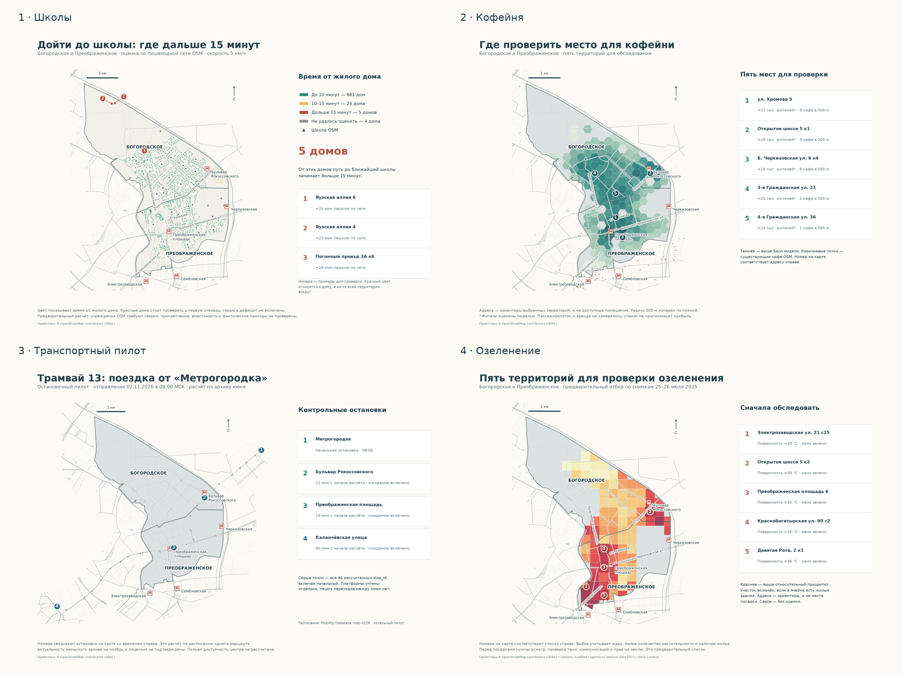

# ГИС-портфолио · Москва

Четыре прикладных проекта для Богородского и Преображенского: Python, QGIS, реальные данные, карты, таблицы и воспроизводимые шаги. Выводы предварительные; транспортный проект пока частичный.

**[Открыть все 9 карт и диаграмм](portfolio-maps/README.md)** · [HTML-галерея для скачанного репозитория](portfolio-maps/all-maps-city.html)

| Проект | Результат и статус | Файлы |
|---|---|---|
| Школы и поликлиники пешком | 713 жилых зданий, время 10/15 минут, возможный дефицит. Предварительная OSM-оценка | [README](moscow-walk-access/README.md) · [QGIS](moscow-walk-access/moscow_walk_access.qgz) |
| Где открыть кофейню | Пять территорий, спрос/конкуренция и устойчивость выбора. Спрос частично оценён по прокси | [README](moscow-location-analysis/README.md) · [QGIS](moscow-location-analysis/moscow_location_analysis.qgz) |
| Транспортная доступность | Проверенный пилот трамвая №13: 46 остановок. Полная карта до центра и сравнение трёх режимов не готовы | [README](moscow-transport-access/README.md) · [QGIS](moscow-transport-access/moscow_transport_pilot.qgz) |
| Зелень и жара | Sentinel-2 + Landsat, NDVI, температура поверхности, связь и приоритеты обследования. Одна пара дат, неполное покрытие | [README](moscow-green-heat/README.md) · [QGIS](moscow-green-heat/moscow_green_heat.qgz) |

В QGIS есть готовые макеты с префиксом «Портфолио ·»: улицы, метро, подписи, адресные ориентиры, легенда и короткие пояснения. Все девять изображений доступны в галерее Markdown. HTML-файлы откроются в браузере после скачивания репозитория; GitHub показывает их исходный код.

Для запуска перейдите в папку выбранного проекта и следуйте его README. Сохранены обработанные GeoPackage/GeoJSON и исходные фрагменты Sentinel/Landsat. Большой исходный OSM-снимок не дублируется; его происхождение и загрузчик находятся в проекте 1. Полные GTFS ZIP не включены: условия распространения не подтверждены; источник, SHA и отдельный загрузчик документированы. Карты пилота не являются полной оценкой транспорта Москвы.

Код — MIT; данные сохраняют собственные условия: © OpenStreetMap contributors / ODbL, Copernicus Sentinel, USGS Landsat. Данные населения имеют отдельное происхождение, указанное в проекте 1.

Посты для портфолио лежат в `docs/post.md` каждого проекта; это тексты, а не публикации в соцсетях. Прежние корневые пути проекта 1 сохранены для совместимости, основные проекты находятся в четырёх папках выше.
