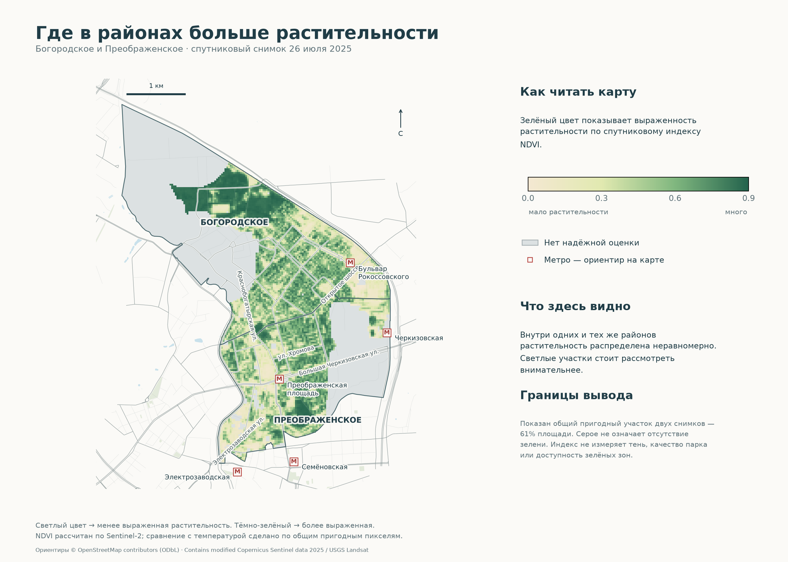
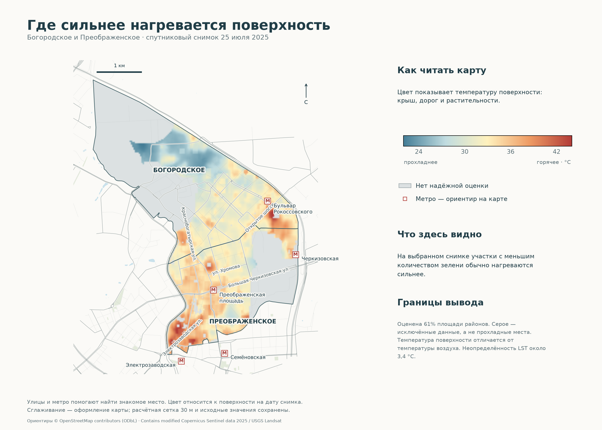
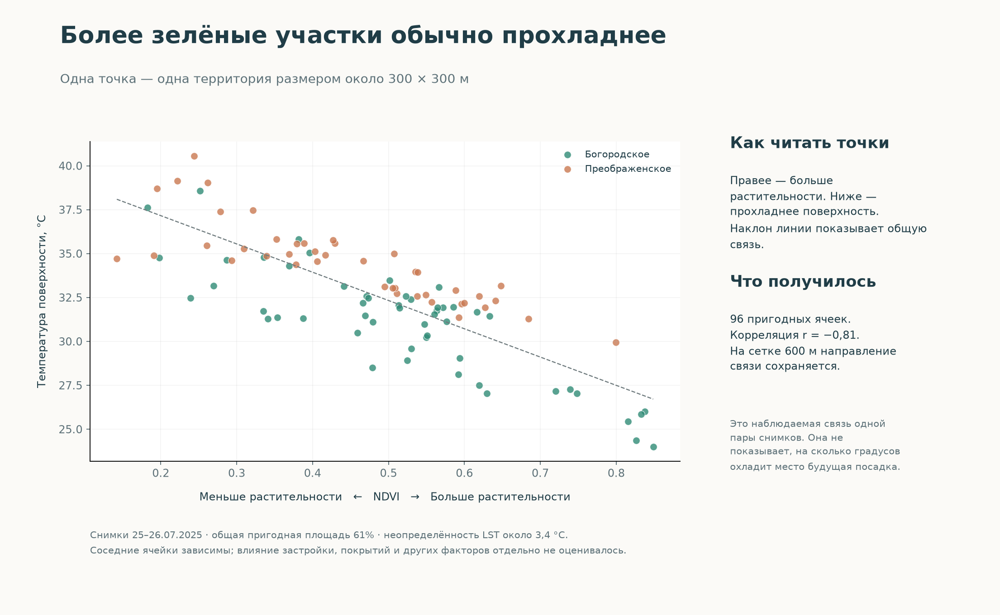

# Зелень и температура поверхности: Богородское и Преображенское

**Все карты в новом оформлении:** [галерея 4 проектов](../portfolio-maps/README.md). В QGIS откройте менеджер макетов: готовые карты начинаются с «Портфолио ·».

**Оформление карт:** добавлены улицы, метро, адреса-ориентиры и короткие пояснения. [Как читать карты и повторить оформление](docs/cartography.md).

**Готовый локальный воспроизводимый кейс с предварительными выводами.** Реальные спутниковые данные, общий пригодный участок — 61% площади районов. Выводы предварительные.

## Задача

Проверить связь растительности с нагревом поверхности и выделить территории с жильём для обследования перед озеленением. Территория — два соседних района Москвы; выводы относятся к одной паре летних сцен, а не ко всему городу или климатической норме.

## Данные

- Copernicus Sentinel-2 L2A: **S2A_37UDB_20250726_0_L2A**, 26.07.2025 08:45 UTC; красный B04 и ближний ИК B08, 10 м, SCL 20 м. Открытые COG через [Element84 Earth Search](https://earth-search.aws.element84.com/v1/collections/sentinel-2-l2a).
- USGS Landsat 9 Collection 2 Level 2: **LC09_L2SP_178021_20250725_02_T1**, 25.07.2025 08:28 UTC; готовая температура ST_B10, QA_PIXEL, QA_RADSAT, ST_QA, ST_CDIST. [Planetary Computer](https://planetarycomputer.microsoft.com/dataset/landsat-c2-l2). Сетка 30 м, исходная тепловая детализация около 100 м.
- Границы и жилые здания © [OpenStreetMap contributors](https://www.openstreetmap.org/copyright), снимок проекта 1. Население для этого анализа не используется.

Сохранены исходные STAC JSON, небольшие окна восьми каналов и `data/raw/manifest.json` с URL и SHA256. Разница дат — около суток. Это архивные сцены 2025 года, а не текущий мониторинг.

## Метод

NDVI = (NIR − RED)/(NIR + RED). В выбранных Sentinel COG уже применено смещение baseline: `earthsearch:boa_offset_applied=true`; повторно вычитать 0,1 нельзя. Отбор SCL 4/5. LST = DN × 0,00341802 + 149 − 273,15 °C ([USGS](https://www.usgs.gov/landsat-missions/landsat-collection-2-surface-temperature)). Исключены облака, тени, снег, вода, насыщение; расстояние до облаков ≥500 м, ST_QA ≤5 K. Средняя неопределённость пригодных пикселей около **3,4 K**; строгий порог 2 K исключает всё, поэтому результат предварительный.

NDVI усреднён на исходную сетку Landsat; доля ясной суши Sentinel ≥80%. Сравнение только по общим пригодным пикселям. В ячейках 300 м нужно ≥70% покрытия и ≥30 пикселей. Pearson/Spearman описывают связь; пространственная зависимость и одна пара дат исключают причинную интерпретацию. Проверены сетка 600 м и ST_QA ≤4 K. Приоритет = среднее рангов высокой LST и низкого NDVI; пять ячеек с жильём разнесены минимум на 600 м. [Полная методика](docs/method.md).

## Вывод

В **96 ячейках 300 м**: Pearson **r = −0,81**, Spearman **ρ = −0,76**. На сетке 600 м: 21 ячейка, r = −0,89; при ST_QA ≤4 K: r = −0,81. Более зелёные ячейки на выбранном участке обычно прохладнее. Найдено 15 ячеек одновременно в верхней четверти LST и нижней четверти NDVI; пять территорий с жильём вынесены в таблицу для обследования.

| Район | Пригодная площадь | NDVI | LST, °C |
|---|---:|---:|---:|
| Богородское | 54,8% | 0,53 | 30,7 |
| Преображенское | 70,4% | 0,45 | 34,2 |

Средние относятся **только к пригодной площади**, а различие районов не является доказанной разницей температуры всего района. Тепловая неопределённость, неодинаковое покрытие, разные дни и типы застройки ограничивают вывод. Температура поверхности не равна температуре воздуха; эмиссионная модель LST связана с растительностью, поэтому показатели не полностью независимы. Отбор ячеек не подтверждает возможность посадок: нужны осмотр, коммуникации, права на землю и повторные сцены.





Температурная карта отображается с билинейным сглаживанием; оно применяется к визуализации, исходные значения и расчёты сохраняются.

Открыть `moscow_green_heat.qgz` в QGIS. Результаты: `data/processed/green_heat.gpkg`, GeoTIFF, CSV в `outputs`, четыре карты/диаграммы PNG и SVG; [пост](docs/post.md), [источники](docs/sources.md), `outputs/validation.json`.

## Повторить

Python 3.13, зависимости `requirements.txt`; точные установленные версии в `requirements.lock.txt`.

```sh
python3 -m venv .venv
.venv/bin/pip install -r requirements.txt
.venv/bin/python src/preprocess.py
.venv/bin/python src/analyze.py
.venv/bin/python src/plot.py
.venv/bin/python src/validate.py
```

Включённые фрагменты позволяют повторить расчёт без сети. `src/discover.py` повторяет подбор сцен; `src/fetch.py` повторяет загрузку окон с бесплатным анонимным доступом (временные SAS не сохраняются). Для пересоздания проекта выполнить `src/qgis_project.py` в Python QGIS; проверено в QGIS 3.42.1. Валидация переносимости требует включённого `.qgz`.
