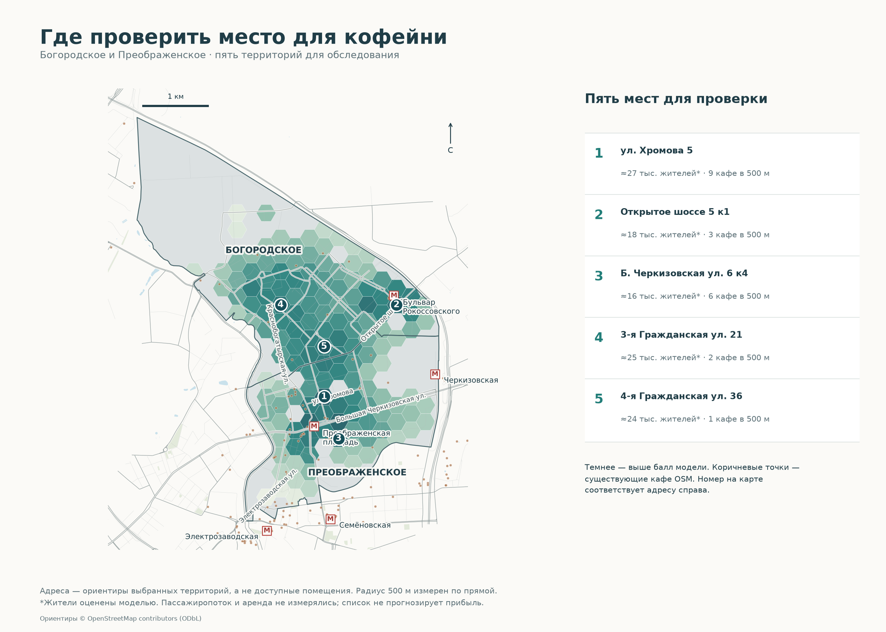

# Где проверить локацию кофейни

**Все карты в новом оформлении:** [галерея 4 проектов](../portfolio-maps/README.md). В QGIS откройте менеджер макетов: готовые карты начинаются с «Портфолио ·».

**Оформление карт:** добавлены улицы, метро, адреса-ориентиры и короткие пояснения. [Как читать карты и повторить оформление](docs/cartography.md).

Богородское и Преображенское · проект 02 · **предварительный анализ на прокси спроса**.

**Задача.** Составить топ-5 территорий для дальнейшего обследования под кофейню: спрос рядом с жильём, офисами и транспортом против числа конкурентов. Точка на карте — центр ячейки, а не предложенное в аренду помещение.

**Данные.** Снимок OSM от 01.11.2026, повторно использованный из проекта 01: кафе, офисные объекты, остановки, метро, жилые здания, границы, сеть проходов. После очистки — 662 POI в зоне районов с запасом 650 м. Население — модель площади × этажности из проекта 01, с вторичными районными итогами за 2025 год. Пассажиропоток data.mos.ru и число работников офисов отсутствуют: транспортные узлы и офисы используются как **инфраструктурные индикаторы**, а не измеренные люди.

**Метод.** EPSG:32637. Гексагоны со стороной 150 м, радиус обслуживания 500 м **по прямой**. Кандидаты: ≥300 оценочных жителей в радиусе, ≥100 м² жилых пятен внутри ячейки, центр ≤60 м от сети. Всего 245 ячеек, пригодных 149. Показатели нормируются на 95-й процентиль пригодных ячеек и ограничиваются единицей. Балл = 100 × (0.45 × жители + 0.25 × офисы + 0.20 × метро + 0.10 × остановки − 0.30 × кафе). Метро сгруппировано из входов в узлы по связности в пределах 250 м. Топ-5 выбирается с расстоянием ≥600 м между центрами. Проверены ещё четыре набора весов; [устойчивость рейтинга](outputs/top5_sensitivity.png).

| № | Ориентир рядом | Балл | Жители 500 м, оценка | Офисы | Узлы метро | Кафе |
|---|---|---:|---:|---:|---:|---:|
| 1 | улица Хромова 5 | 64.1 | 27163 | 8 | 1 | 9 |
| 2 | Открытое шоссе 5 к1 | 58.1 | 17846 | 7 | 1 | 3 |
| 3 | Большая Черкизовская улица 6 к4 | 57.8 | 16121 | 14 | 1 | 6 |
| 4 | 3-я Гражданская улица 21 | 53.9 | 25125 | 7 | 0 | 2 |
| 5 | 4-я Гражданская улица 36 | 51.9 | 24098 | 2 | 0 | 1 |

**Вывод.** Это адресный шорт-лист для проверки входов, аренды, видимости, реального потока и конкурентов. Близость к метро и число офисов не заменяют наблюдение трафика; отсутствие кафе в OSM не доказывает отсутствие конкуренции. Жильё за границами двух районов не включено в спрос, поэтому крайние ячейки могут быть занижены. Пешеходные обходы, нежилые этажи, доходы, аренда и выручка не моделируются. Зоны разных кандидатов могут перекрываться; население по ним не суммируется.

[Топ-5 CSV](outputs/top5.csv) · [все ячейки](outputs/all_cells.csv) · [GeoPackage](data/processed/location_analysis.gpkg) · [QGIS](moscow_location_analysis.qgz) · [пост](docs/post.md) · [аудит](outputs/quality_report.json).

Воспроизведение из этой папки: `python3 -m venv .venv`, затем `.venv/bin/pip install -r requirements.lock.txt` и `.venv/bin/python src/analyze.py`. Все входы для основного анализа находятся в `data/raw`; соседний проект 01 требуется только для необязательного повторного извлечения полного OSM через `src/extract_osm.py`. Карты и проверки генерируются одним запуском. Проект QGIS создаёт `src/qgis_project.py` через Python из установки QGIS.

Код MIT; геоданные © OpenStreetMap contributors, ODbL 1.0. Даты, контрольные суммы, формулы и все сценарии — в отчёте качества. Измеренный пассажиропоток и первичные итоги населения требуют подключения перед окончательным выпуском кейса.
