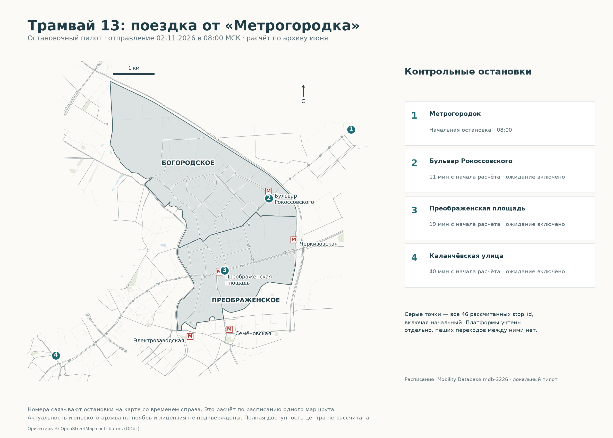

# Транспортная доступность Москвы: проверенный остановочный пилот

**Все карты в новом оформлении:** [галерея 4 проектов](../portfolio-maps/README.md). В QGIS откройте менеджер макетов: готовые карты начинаются с «Портфолио ·».

**Оформление карт:** добавлены улицы, метро, адреса-ориентиры и короткие пояснения. [Как читать карты и повторить оформление](docs/cartography.md).

**Частичный проект.** Реальный GTFS, код расписаний, карта остановок и QGIS готовы. Исходная задача «время от ячеек города до центра на транспорте, пешком и машине» **не выполнена**: необходимые источники неполны.

## Задача

Рассчитать поездки до согласованной доступной точки центра с подходом, ожиданием, пересадками и выходом, сравнить три режима. До подтверждения полноты источников выполнен ограниченный контрольный расчёт: трамвай №13, от остановки **3949 «Метрогородок»**, **02.11.2026 08:00 МСК**, маршрут `422`.

## Данные

[Mobility Database mdb-3226](https://mobilitydatabase.org/feeds/gtfs/mdb-3226), community feed, архив **30.06.2026**: 877 маршрутов, 17 896 остановок, 224 851 рейс, 6 227 078 записей stop_times. В нём нет маршрутов метро; актуальность на ноябрь и лицензия не подтверждены. Исходный ZIP сохранён, SHA проверен. В отдельной копии удалены только пустые безымянные столбцы, без потери значений. Четыре agency без URL и другие ограничения полной GTFS-валидности остаются. [Аудит](docs/source-audit.md).

Координаты карты — исходные точки GTFS. Границы и справочное жильё © OpenStreetMap contributors, ODbL, повторно использованы из проекта 1. Геометрия движения не придумана: линии между остановками и изохроны не строились. Исходный полный GTFS ZIP в репозиторий не включён: условия распространения не установлены. Пилот показывает ограниченный результат, не полный набор расписаний.

## Метод

Connection Scan: календарь, часы ≥24, ожидание, pickup/dropoff; продолжение того же рейса без штрафа, пересадка на той же остановке — 120 секунд. Нет пеших связей, подхода/выхода, предыдущего service day, метро/МЦД и задержек. При frequencies/transfers/pathways движок явно останавливается. Пять unit-тестов пройдены; независимый алгоритм повторного обхода целых рейсов совпал по всем 46 временам. [Методика](docs/timetable-method.md).

## Вывод пилота

Обработано **5 954 связи**, достигнуто **46 остановок**, включая исходную. До платформы у метро «Бульвар Рокоссовского» — 11 минут, «Преображенская площадь» — 19, до одной из остановок «Каланчёвская улица» — 40. Это расчёт по архивному расписанию, не обещание времени текущей поездки.

Противоположные платформы остаются разными stop_id без пешего перехода: отдельные времена достигают 86 минут после объезда. Такие значения нельзя трактовать как доступность улицы или района. Наличие остановки с названием метро не означает, что в расчёт включено само метро. Отсутствующие режимы нельзя записать как плохую доступность жителей.



Открыть **`moscow_transport_pilot.qgz`**: семь слоёв с относительными путями. `data/processed/transport_pilot.gpkg`, GeoJSON, `outputs/tram13_stop_arrivals.csv`, PNG/SVG, [пост](docs/post.md). Карта до центра и сравнение режимов отсутствуют; [точный список пробелов](docs/remaining-work.md).

## Воспроизвести

Python 3.13; аудит, нормализация, движок и тесты используют стандартную библиотеку. Экспорт/карта требуют `requirements.txt`. В репозитории сохранены результаты пилота и происхождение данных. Полный GTFS ZIP не включён; при наличии права использования его можно скачать по сохранённому адресу и проверить SHA.

```sh
python3 src/download_gtfs.py
python3 src/audit_gtfs.py
python3 src/normalize_gtfs.py
python3 -m unittest discover -s tests -v
python3 src/timetable.py --feed data/raw/moscow_gtfs_header_normalized.zip --service-date 20261102 --route-id 422 --origin-stop 3949 --departure 08:00:00 --output outputs/tram13_stop_pilot.json
python3 src/validate_pilot.py
python3 src/export_pilot.py
python3 src/plot_pilot.py
python3 src/validate_artifacts.py
```

Для нового окружения: `python3 -m venv .venv`, затем `.venv/bin/pip install -r requirements.txt`; использовать `.venv/bin/python` в командах. Для пересоздания QGIS выполнить `src/qgis_project.py` в Python QGIS после экспорта; проверено QGIS 3.42.1. Полный GTFS скачивается отдельно скриптом `src/download_gtfs.py`; нормализованную копию создаёт `normalize_gtfs.py`.
