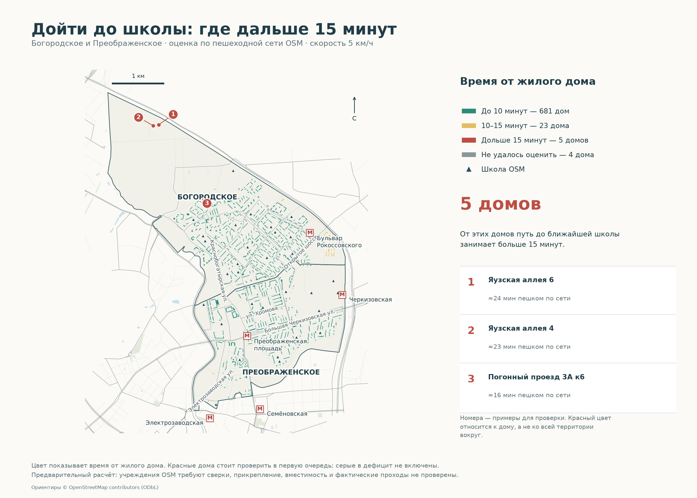

# 15 минут пешком: школы и поликлиники

**Все карты в новом оформлении:** [галерея 4 проектов](../portfolio-maps/README.md). В QGIS откройте менеджер макетов: готовые карты начинаются с «Портфолио ·».

**Богородское и Преображенское, Москва · проект 01 · предварительный анализ по OSM.**



**Задача.** Найти жилые здания вне 10- и 15-минутной пешеходной доступности школ и поликлиник и оценить население в возможных зонах дефицита. Анализ охватывает два района; соседние учреждения учитываются в пределах запаса 2 км.

**Данные.** Дороги, здания, входы и учреждения — [OpenStreetMap](https://www.openstreetmap.org/copyright), снимок 01.11.2026. Границы — Nominatim/OSM. Районные итоги населения на 01.01.2025: 108 907 и 89 475 человек, **вторичная выписка из Википедии со ссылкой на Росстат**; оригинал XLSX недоступен и не проверен. [Происхождение и ссылки](data/raw/population_provenance.json). Официальные перечни data.mos.ru пока не загружены; их не подменяем утверждением о полноте OSM.

**Метод.** Python + GeoPandas + NetworkX + Shapely + PyQGIS. Метрическая проекция UTM 37N (EPSG:32637). Скорость 5 км/ч, бюджеты 833 и 1 250 м. В графе сохраняются общие узлы OSM, переходы и проходы; пересечения без общего узла не соединяются. Учитываются теги запрета прохода. Точки входов привязываются к ближайшему ребру с его разбиением, длина соединителя входит во время. Соединитель свыше 100 м или отсутствие пути в компоненте графа означает неопределённость. Население распределяется по площади × этажности; пропуски этажности заполнены медианой района. Изохроны каждого учреждения — доступные части рёбер с визуальным коридором ±18 м, без заливки недоступных кварталов выпуклой оболочкой.

**Предварительный результат.** 713 жилых зданий; 96 школьных и 24 поликлинических объектов OSM в расширенной зоне. Таблица упорядочена по оценке населения вне 15 минут отдельно для каждого типа:

| Район | Тип | Жилых зданий | Зданий вне 15 мин | Жителей вне 15 мин, оценка | Жителей без привязки, оценка |
|---|---|---:|---:|---:|---:|
| Богородское | Поликлиники | 452 | 112 | 31 374 | 1 608 |
| Преображенское | Поликлиники | 261 | 28 | 12 032 | 17 |
| Богородское | Школы | 452 | 5 | 1 952 | 1 608 |
| Преображенское | Школы | 261 | 0 | 0 | 17 |

**Вывод.** Красные здания — кандидаты на проверку дефицита: в графе найден путь дольше 15 минут. Дома в изолированных компонентах отмечены отдельно как неопределённые. Это ещё не доказательство отсутствия обслуживания. Полнота OSM, фактические входы и закрытые территории могут изменить результат; прикрепление, возраст пациентов, вместимость школ и ожидание светофора не моделируются. Оценки жителей по школам и поликлиникам нельзя складывать. Данные населения 2025 года и сеть 2026 года относятся к разным датам.

**Открыть результат:** [интерактивная карта без интернета](outputs/interactive_map.html) · [поликлиники](outputs/clinic_access.png) · [таблица CSV](outputs/district_deficit.csv) · [проект QGIS](moscow_walk_access.qgz) · [GeoPackage](data/processed/accessibility.gpkg) · [пост](docs/post.md).

**Воспроизвести** (Python 3.13; запуск из корня репозитория):

```bash
python3 -m venv .venv
.venv/bin/pip install -r requirements.lock.txt
.venv/bin/python src/download.py
.venv/bin/python src/analyze.py
.venv/bin/python src/interactive_map.py
.venv/bin/python src/write_report.py
.venv/bin/python -m unittest discover -s tests -v
.venv/bin/python src/validate_outputs.py
```

QGIS-проект создаётся `src/qgis_project.py` через Python из установки QGIS; [пример для macOS и подробная методика](docs/method.md). Готовый `.qgz` открывается обычным QGIS рядом с папкой `data`. Для повторения чисел нужен исходный снимок из локального архива; повторная загрузка OSM позже даст другой результат. Контрольные суммы — `data/raw/manifest.json`.

**Статус перед публикацией:** расчёт и оформление готовы как предварительная версия; остаются сверка с data.mos.ru, проверка оригинала населения и натурная/картографическая проверка красных зданий. [Отчёт качества](outputs/quality_report.json). Код — MIT; производные геоданные OSM — ODbL 1.0. Авторство данных и источников сохраняется.
