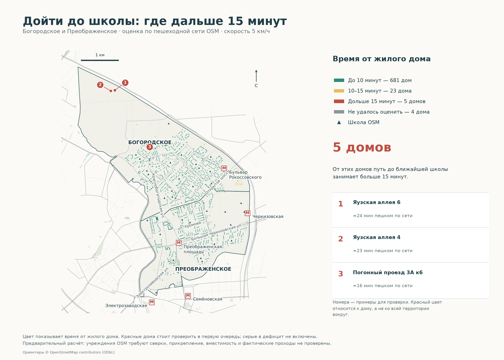
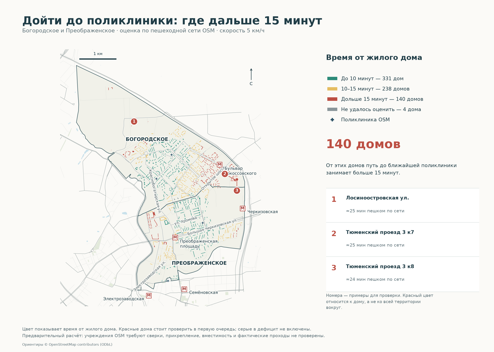
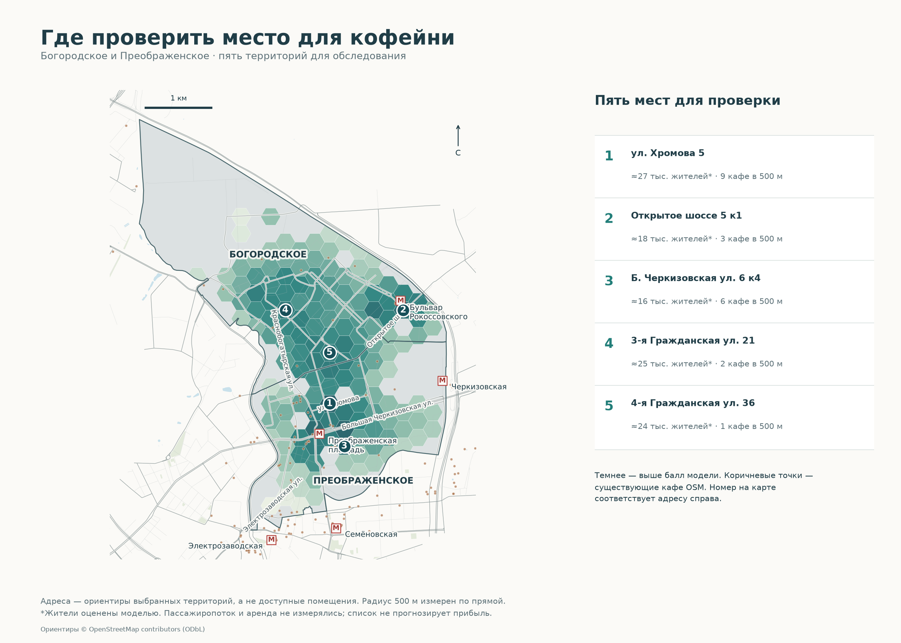
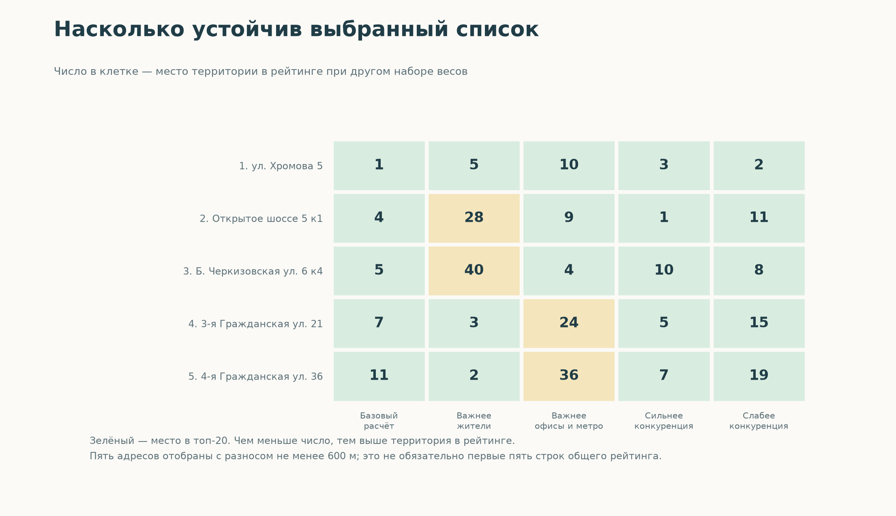
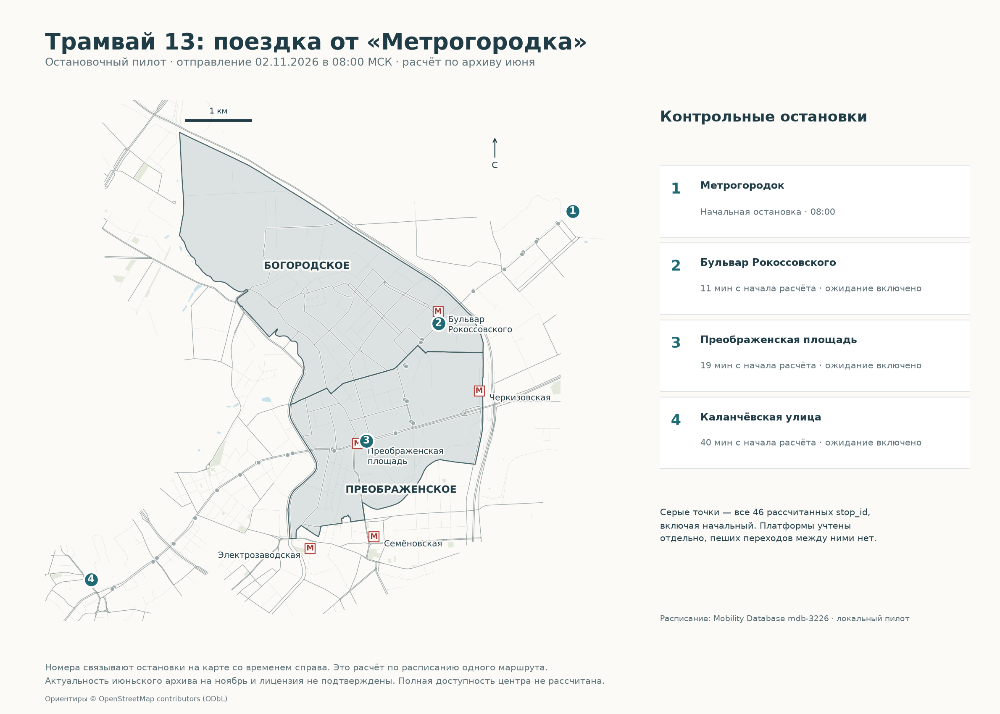
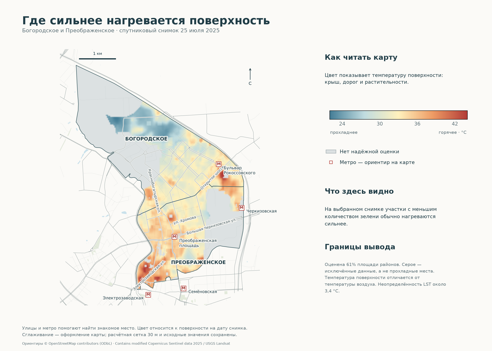
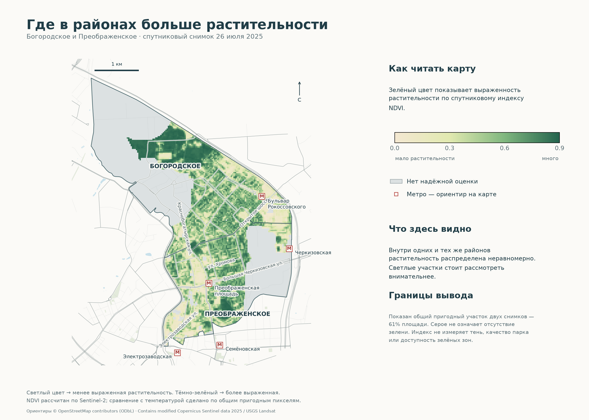
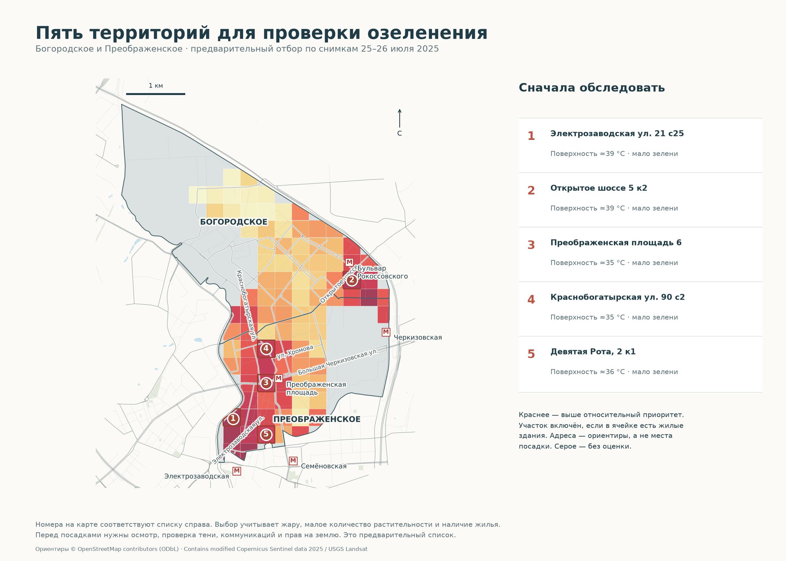
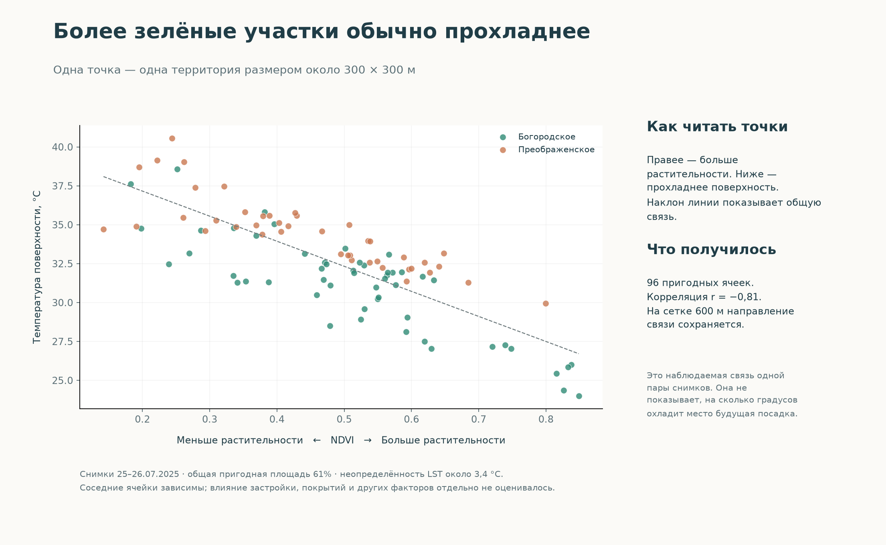

# Все карты · городское оформление

4 проекта · 7 карт · 2 диаграммы. [Вернуться к портфолио](../README.md).

## Школы: где дольше 15 минут

[PNG крупно](01-school-city.png) · [SVG](01-school-city.svg)

## Поликлиники: где дольше 15 минут

[PNG крупно](02-clinic-city.png) · [SVG](02-clinic-city.svg)

## Где проверить место для кофейни

[PNG крупно](03-coffee-city.png) · [SVG](03-coffee-city.svg)

## Устойчивость выбранных мест

[PNG крупно](04-location-stability.png) · [SVG](04-location-stability.svg)

## Трамвай 13: остановочный пилот

[PNG крупно](05-tram-city.png) · [SVG](05-tram-city.svg)

## Где сильнее нагревается поверхность

[PNG крупно](06-heat-city.png) · [SVG](06-heat-city.svg)

## Где больше растительности

[PNG крупно](07-vegetation-city.png) · [SVG](07-vegetation-city.svg)

## Где проверить возможность озеленения

[PNG крупно](08-greening-city.png) · [SVG](08-greening-city.svg)

## Зелень и температура: как связаны

[PNG крупно](09-green-heat-relation.png) · [SVG](09-green-heat-relation.svg)

